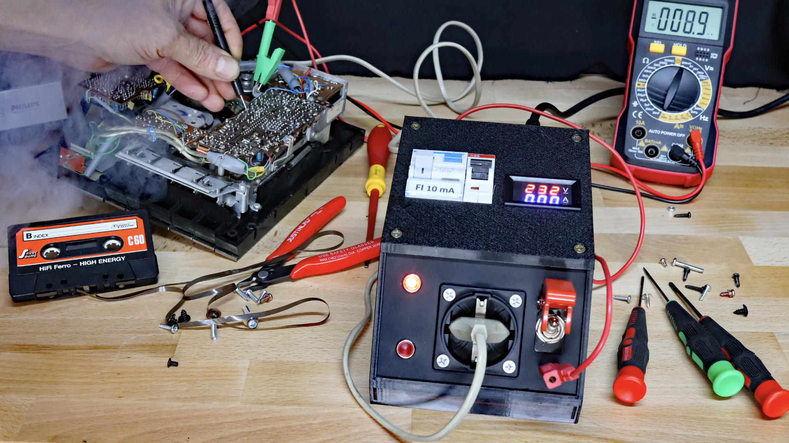

Maker Media GmbH

***

# Personenschutz für elektrische Reparaturen

**Beim Reparieren defekter Geräte können schon mal Sicherungen rausfliegen. Das ist auch gut so, ein Stromausfall ist aber dennoch selten willkommen. Mit dem hier gezeigten Personenschutzgerät lässt sich das vermeiden und es reagiert sogar noch empfindlicher als handelsübliches Equipment.**

Hier liegen die 3D-Druckdaten für das Personenschutzgehäuse.

Der vollständige Artikel zum Projekt steht in der **[Make-Ausgabe 6/26](https://www.heise.de/select/make/2026/6)**.
